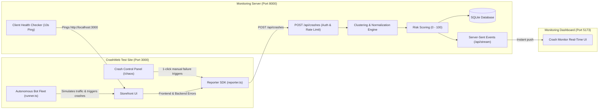

# End-to-End Crash Monitoring Ecosystem

An end-to-end incident monitoring, automated error clustering, and risk scoring system demonstrating how autonomous traffic and chaos testing connect directly to modern observability.

- **REPO 1 (Monitoring Server & Dashboard)**: `hackmitten/` (FastAPI backend + React 18/Vite dashboard)
- **REPO 2 (Target Test Site / "Victim")**: `crashweb/` (Next.js 16 storefront + Chaos module + Bot runner + Reporter SDK)

---

## Architecture



---

## 🚀 One-Command Start: `npm run demo`

From this root repository, start all three services together with a single command:

```sh
npm run demo
```

This launches:
1. **Monitoring Backend**: [http://localhost:8000](http://localhost:8000)
2. **Monitoring Dashboard**: [http://localhost:5173](http://localhost:5173)
3. **CrashWeb Storefront**: [http://localhost:3000](http://localhost:3000)
4. **Crash Control Panel**: [http://localhost:3000/chaos](http://localhost:3000/chaos)

To run the standalone CLI bot runner in another terminal:
```sh
npm run bots
```

---

## 🎯 Live Presentation Demo Script for Judges

1. **Open the Monitoring Dashboard**:
   Navigate to [http://localhost:5173](http://localhost:5173).
   - Point out the **Live Status Banner** at the top showing the monitored site's health (`HEALTHY`), latency, and uptime.
   - Point out the **High-Risk Errors Spotlight** auto-flagging critical failures.
   - Point out the **Category Breakdown Bar** and the searchable **Clusters Grid**.

2. **Open the Crash Control Panel**:
   Navigate to [http://localhost:3000/chaos](http://localhost:3000/chaos).
   - Show the 1-click chaos triggers across **Frontend** (Uncaught Exceptions, Unhandled Rejections, Memory Leaks), **Backend** (Database Pool Exhaustion, HTTP 500s, Timeouts), and **Network** (502s, 429s).
   - Click **START BOTS** with mode set to `STRESS` or `RANDOM`. Notice the live bot request counter incrementing.

3. **Verify Real-Time Clustering & Risk Scoring**:
   Switch back to [http://localhost:5173](http://localhost:5173).
   - Within seconds, notice the **Live Ingestion Stream** pulsing with incoming crashes.
   - Notice the **Crash Rate (/min)** indicator updating in real time.
   - Watch the Database Connection Pool failure score surge into the **CRITICAL** tier ($\ge 80$), accompanied by a red **Spike Detected (5x)** alert banner.
   - Notice that identical errors are automatically normalized and deduplicated into a single cluster rather than flooding the dashboard with duplicate cards.

4. **Deep Dive into Cluster Details**:
   - Click the top High-Risk card to open the **Cluster Detail Drawer**.
   - Show the **Plain-English Explanation** and the **Recommended Fix**.
   - Show the clean, normalized **Stack Trace** with one-click copy.
   - Demonstrate the resolution workflow by clicking **Mark as Resolved**.

5. **Export Incident Report**:
   - Click **Export JSON** or **CSV** to download a comprehensive incident report for post-mortem review.

---

## 🛡️ Safety & Allowlist Guarantee

Automated bots and chaos scripts are strictly restricted to local CrashWeb environments (`localhost:3000`, `127.0.0.1:3000`). Attempting to target external domains is rejected with a fatal security violation. Only test sites you own.

---

## 🧪 Running Unit Tests

```sh
$env:PYTHONPATH="hackmitten/backend"
hackmitten/backend/.venv/Scripts/pytest hackmitten/backend/tests/
```
All unit tests pass (normalization, fingerprinting, near-duplicate merging, risk scoring, safety guards).

