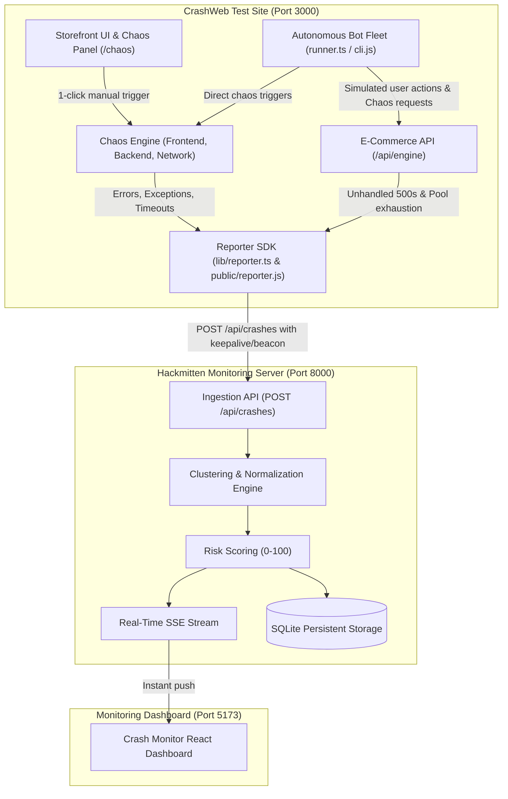

# CrashWeb (Target Test Site / "Victim")

A deployable Next.js 16 storefront ("Zon Commerce") with an integrated **Chaos Engineering Engine**, **Automated Bot Runner**, and **Lightweight Error Reporter SDK**. It deliberately triggers controlled runtime failures to demonstrate real-time error clustering and risk scoring in the Hackmitten Monitoring Server.

---

## ⚠️ Security Policy & Safety Allowlist

> [!CAUTION]
> **STRICT TARGET ALLOWLIST**: Automated bots and chaos injection scripts are hardcoded and restricted to local CrashWeb environments (`localhost:3000`, `127.0.0.1:3000`, `0.0.0.0:3000`).
> Attempting to target external domains is blocked at the network barrier and will immediately terminate execution. Only test websites you own.

---

## Architecture



---

## Features

### 1. Chaos Engineering Module (`lib/chaos.ts` & `/api/chaos`)
- **Frontend Scenarios**:
  - Uncaught JS exceptions
  - Unhandled promise rejections
  - Null/undefined property dereferences (`TypeError`)
  - Infinite loops / UI event-loop freezes
  - Memory leak simulation (unbounded buffer allocations)
  - Broken network calls (`fetch` failures)
  - Failed resource loads (broken 404 images/scripts)
  - Invalid JSON parsing syntax errors
  - React component render boundary errors
- **Backend Scenarios**:
  - HTTP 500 Internal Server Errors (deadlocks, unhandled logic)
  - Database connection pool exhaustion (`DB_POOL_EMPTY`, 503)
  - Server request timeouts (hanging responses, 504)
  - Backend null pointer / TypeError exceptions
  - Out-of-memory heap pressure simulation
  - Slow endpoints (artificial 3000ms latency)
  - Malformed payload handling (HTTP 400)
- **Network Scenarios**:
  - HTTP 4xx (400, 404, 401, 403)
  - HTTP 5xx (500, 502 Bad Gateway, 503, 504)
  - CORS policy restrictions
  - Rate limiting (HTTP 429 Too Many Requests)

### 2. Autonomous Bot Fleet (`bots/runner.ts` & `bots/cli.js`)
- Configurable bot count (1–10 bots) and dispatch interval (400ms – 3000ms).
- **Four Simulation Modes**:
  - `gentle`: Realistic browsing, product searches, carts, and rare minor blips.
  - `random`: Balanced mixture of shopping behavior and random chaos crashes.
  - `stress`: High-frequency burst mode generating concurrent checkout errors and backend deadlocks.
  - `targeted`: Relentlessly strikes a designated scenario (e.g. database pool exhaustion or memory leak).
- Controllable from the browser via the **Crash Control Panel** (`/chaos`) or via CLI:
  ```sh
  npm run bots
  # or custom parameters:
  BOT_COUNT=5 MODE=stress TARGET_URL=http://localhost:3000 npm run bots
  ```

### 3. Lightweight Reporter SDK (`lib/reporter.ts` & `public/reporter.js`)
- Captures and reports structured crash payloads:
  ```json
  {
    "projectId": "proj_crashweb_01",
    "timestamp": "2026-10-28T14:30:00Z",
    "errorType": "DatabaseConnectionError",
    "message": "Connection pool exhausted (0/50 available)",
    "stackTrace": "DatabasePoolError: ...",
    "url": "/api/engine?action=checkout",
    "httpStatus": 503,
    "userAgent": "Mozilla/5.0 ...",
    "browser": "Chrome",
    "os": "Windows",
    "sessionId": "sess_482b1",
    "botId": "bot-1",
    "severityHint": "critical",
    "environment": "production"
  }
  ```
- **Loop & Crash Prevention**:
  - Never intercepts its own `/api/crashes` reporting calls.
  - In-memory rate limiting (max 25 reports per 5 seconds).
  - Deduplicates identical errors occurring within 2 seconds.
  - Completely wrapped in silent fail-safes so reporting errors never crash the website.

### 4. Crash Control Panel (`/chaos`)
- Dedicated web control plane with:
  - Real-time bot fleet status (Active bots, Total requests, Crashes generated, Live activity feed).
  - One-click trigger buttons grouped into Frontend, Backend, and Network failure scenarios.
  - Direct links to the Monitoring Dashboard (`http://localhost:5173`).

---

## Getting Started

```sh
# 1. Install dependencies
npm install

# 2. Run CrashWeb
npm run dev -- --port 3000

# 3. Launch CLI bots (optional)
npm run bots
```

Open:
- Storefront: [http://localhost:3000](http://localhost:3000)
- Crash Control Panel: [http://localhost:3000/chaos](http://localhost:3000/chaos)
