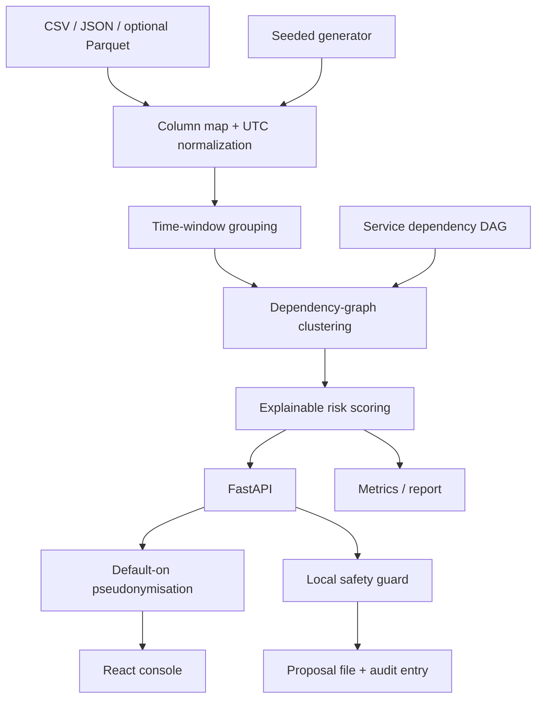

# Architecture

The Python API owns synthetic data generation, normalization, correlation, evaluation and the proposal audit trail. The React/Vite client reads `/api` and does not hold raw integration credentials. The prototype follows the diagram's stages: ingestion and parsing, time-window deduplication, dependency-graph checks for cross-service clusters, explainable risk scoring, and a clean dashboard. The current score is a deterministic weighted baseline, not a trained ML model.

All data shown in the demo is synthetic. The engine does not use ground-truth incident IDs to group alerts; incident links are used by evaluation only.
