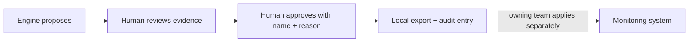

# Safety controls

## Data confidentiality

- API payloads pass through deterministic pseudonymisation for IP addresses, hostnames, customer IDs, emails and token-like strings.
- Demo mode is synthetic. `data/raw/` is gitignored.
- Redaction runs before API responses. Do not add raw alert text to logs.

## Human-in-the-loop

The arrow to the monitoring system is outside this application. The API contains no integration write path. Approve and reject require a person and reason; approval exports a `NOT APPLIED — export only` JSON proposal. Historically incident-linked signatures are guarded against demotion.

## Read-only integration boundary

There is no live connector in this prototype. Any future connector must expose read methods only and must not add mutation methods. Alert text is untrusted data and must never become instructions to a model or trigger an action.

## Threat model

The primary risks are identifier leakage in UI/export/logs, unsafe recommendations caused by sparse or biased history, and prompt injection if a future optional summarizer consumes alert text. Keep redaction at the API boundary, preserve evidence, require a human name and reason, and keep any summary model isolated from tools and action endpoints. Feedback is evaluation data and must not automatically deploy a model update.

## Evidence checklist

- [x] Redaction is enabled on API responses by default.
- [x] Approval only writes a local export and audit record.
- [x] No monitoring-system write adapter is present.
- [x] Protected historically linked signatures cannot be approved for demotion.
- [x] Synthetic data is visibly labelled.
- [ ] API-wide injected-PII scan and production log scan: not yet implemented.
- [ ] Real provider connector security review: no connector exists.
